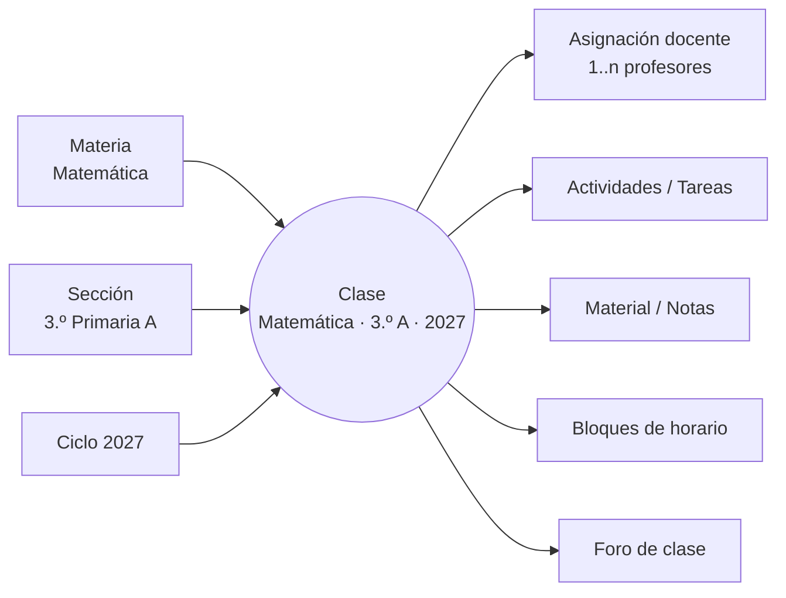
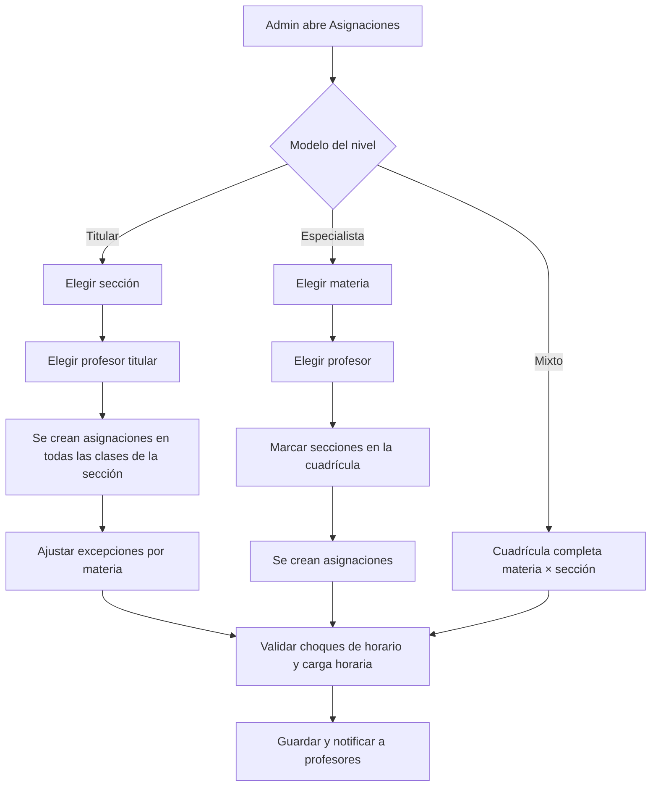

# 03 · Modelo académico flexible

Este es el punto de diseño **más importante** para que el producto sea estándar: distintos colegios organizan a sus docentes de forma distinta.

## 1. Los dos modelos de trabajo

| | **Modelo Especialista** | **Modelo Titular (grado)** |
|---|---|---|
| Típico en | Secundaria, básicos, diversificado, colegios grandes | Preprimaria, primaria, colegios pequeños |
| El profesor imparte | 1–2 materias | Todas las materias |
| A cuántas secciones | Muchas (3.º A, 3.º B, 4.º A, 5.º C...) | Una sola sección |
| Su vista principal | Agrupada **por materia** → secciones | Agrupada **por sección** → materias |
| Ejemplo | Prof. López: Matemática en 4.º A, 4.º B, 5.º A, 5.º B | Profa. Pérez: 2.º Primaria B, todas las materias |

Y es común el **modelo mixto**: en primaria la titular imparte casi todo, pero Inglés, Educación Física y Computación las dan especialistas.

## 2. Solución: la "Clase" como unidad única

En lugar de construir dos sistemas, **todo se basa en la entidad `Clase`** = Materia × Sección × Ciclo.



- Una **asignación docente** vincula un profesor con una clase (con rol: `principal`, `auxiliar`, `practicante`).
- **Modelo especialista** = un profesor con asignaciones en muchas clases de la *misma materia* y distintas secciones.
- **Modelo titular** = un profesor con asignaciones en *todas las clases* de *una sección*.
- **Modelo mixto** = combinación libre, sin reglas especiales.

Por lo tanto **el modelo de datos es el mismo**; lo único que cambia es:

1. **La herramienta de asignación** que ofrece el administrador (asistente por sección o asistente por materia).
2. **Cómo se agrupa la interfaz** del profesor.
3. **Validaciones opcionales** (p. ej. en modo titular, advertir si una sección tiene materias sin profesor).

## 3. Configuración por nivel

El modelo se configura **por nivel**, porque en un mismo colegio primaria puede ser titular y secundaria especialista:

```
Nivel.modelo_asignacion ∈ { ESPECIALISTA, TITULAR, MIXTO }
```

## 4. Asistentes de asignación (Administrador)

### Asistente "por sección" (modelo titular)
1. Elegir sección (2.º Primaria B).
2. Elegir profesor titular → se asigna a todas las clases de la sección.
3. Excepciones: cambiar el profesor de materias específicas (Inglés → Prof. Smith).

### Asistente "por materia" (modelo especialista)
1. Elegir materia (Física).
2. Elegir profesor.
3. Marcar las secciones en una cuadrícula grado × sección.



## 5. Interfaz del profesor según su carga

La interfaz **detecta automáticamente** la forma de la carga del profesor (no depende solo de la configuración):

- Si todas sus clases son de una sola sección → vista **"Mi sección"** con pestañas por materia y un libro de calificaciones consolidado de todas las materias.
- Si sus clases son de pocas materias en muchas secciones → vista **"Mis materias"** con lista de secciones; publicación de tareas en varias secciones a la vez.
- Si es mixto → lista simple de clases con filtros.

## 6. Horario

`BloqueHorario (clase, día_semana, hora_inicio, hora_fin, aula)`.

- Modelo titular: el horario suele ser el de la sección; el profesor "vive" en una aula.
- Modelo especialista: el horario es el del profesor; se valida que no tenga dos bloques simultáneos.
- El alumno ve el horario de su sección; el profesor ve la unión de los bloques de sus clases.
- Las "tareas próximas en horarios" del alumno se muestran sobre la agenda semanal junto con sus bloques de clase.

## 7. Casos especiales contemplados

| Caso | Solución |
|---|---|
| Materias electivas / grupos que mezclan secciones (p. ej. Inglés por nivel de dominio) | `Clase` puede tener **inscripción explícita** de alumnos en lugar de "todos los de la sección" (`clase.tipo = SECCION | GRUPO`). |
| Dos profesores en la misma clase | Varias asignaciones en la clase; ambos califican. |
| Profesor sustituto temporal | Asignación con `fecha_inicio` / `fecha_fin`. |
| Alumno trasladado de sección a mitad de ciclo | Se mantiene el historial de calificaciones por clase; en la nueva sección se trasladan notas (configurable). |
| Materias que no se califican numéricamente (conducta, hábitos en preprimaria) | Escala cualitativa por materia. |
| Materias que agrupan sub-materias (Ciencias = Biología + Química) | `Materia.padre_id` y la nota del padre se calcula ponderando las hijas. *(PLUS)* |
