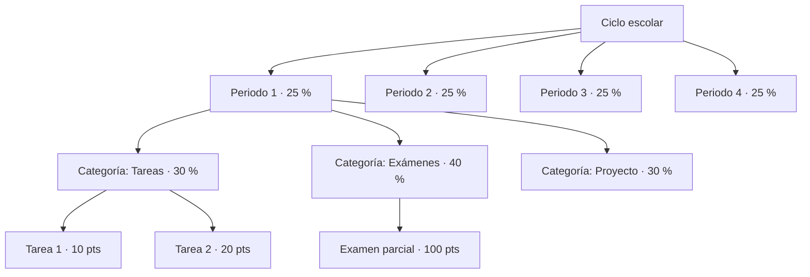

# 04 · Calificaciones y promedios

## 1. Conceptos



- **Escala**: rango (0–100, 0–10, 1–5), mínimo de aprobación, decimales a mostrar, y opcionalmente equivalencias de letra (A ≥ 90...).
- **Categoría**: agrupa actividades dentro de una clase y periodo, con un peso porcentual.
- **Actividad**: tiene un `punteo_maximo`. La nota del alumno se guarda como puntos obtenidos.

## 2. Dos métodos de cálculo (configurable por colegio/nivel)

Los colegios trabajan de dos formas; ambas deben soportarse.

### Método A — Por categorías ponderadas (estilo "porcentajes")

Para cada categoría *c* del periodo:

```
porcentaje_c = Σ puntos_obtenidos(actividades calificadas de c)
             / Σ punteo_maximo(actividades calificadas de c)
```

Nota del periodo (en escala 0–100):

```
nota_periodo = Σ (porcentaje_c × peso_c) / Σ peso_c   (solo categorías con al menos una actividad calificada)
```

### Método B — Por puntos acumulados (estilo "zona + examen")

Muy usado en Centroamérica: el periodo vale 100 puntos, repartidos entre actividades (p. ej. zona 60 pts + examen final 40 pts). Cada actividad tiene un `valor` en puntos sobre la nota del periodo.

```
nota_periodo = Σ ( puntos_obtenidos / punteo_maximo × valor_actividad )
```

Y el sistema **valida** que la suma de valores de las actividades no exceda 100 (alerta al profesor de cuántos puntos le quedan por asignar).

### Nota final del ciclo

```
nota_final = Σ (nota_periodo_p × peso_p) / Σ peso_p
```

o, si el colegio lo configura, **promedio simple** de periodos.

### Promedio general del alumno

```
promedio_general = promedio( nota de cada clase que "cuenta para promedio" )
```

Opción: ponderar por créditos/horas de la materia (`materia.creditos`).

## 3. Reglas de estados

| Estado de la entrega | ¿Cuenta para el promedio? |
|---|---|
| Calificada | Sí, con su nota |
| Pendiente de calificar | No (no penaliza mientras el profesor no califica) |
| No entregada (vencida) | Configurable: cuenta como 0 automáticamente, o solo cuando el profesor la marca |
| Exonerada / excusada | No |
| Entrega tardía | Sí, aplicando penalización configurada (p. ej. −10 % por día, máximo −50 %) |

## 4. "Promedio en curso" vs. "promedio proyectado"

- **Promedio en curso**: solo con lo calificado (lo que se muestra al alumno y encargado por defecto).
- **Proyección**: suponiendo 0 en todo lo pendiente — útil para alertas tempranas al coordinador.

El bot de WhatsApp muestra el **promedio en curso** y la cantidad de actividades pendientes, para no alarmar con datos incompletos.

## 5. Redondeo

Configurable: `redondeo = { NINGUNO, MEDIO_ARRIBA, TRUNCAR }` y `decimales`. Se aplica **solo al mostrar y al cerrar el periodo**; los cálculos intermedios se guardan con precisión completa (`numeric(7,4)`).

## 6. Recálculo y rendimiento

- Cada vez que se registra o cambia una nota, se encola un trabajo `recalcular_promedio(alumno, clase, periodo)`.
- Los resultados se guardan en una tabla materializada `resumen_calificacion` (alumno × clase × periodo) para que portales y WhatsApp respondan en milisegundos.
- Al **cerrar el periodo** se congela `nota_periodo_final` (la que va en la boleta), que ya no cambia salvo corrección auditada.

## 7. Ejemplo (Método A)

Clase Matemática, Periodo 1: Tareas 30 %, Exámenes 70 %.

| Actividad | Categoría | Máx | Obtenido |
|---|---|---|---|
| Tarea 1 | Tareas | 10 | 8 |
| Tarea 2 | Tareas | 10 | 10 |
| Parcial | Exámenes | 100 | 75 |

- Tareas: 18/20 = 90 %
- Exámenes: 75/100 = 75 %
- Nota = 0,30 × 90 + 0,70 × 75 = 27 + 52,5 = **79,5**
