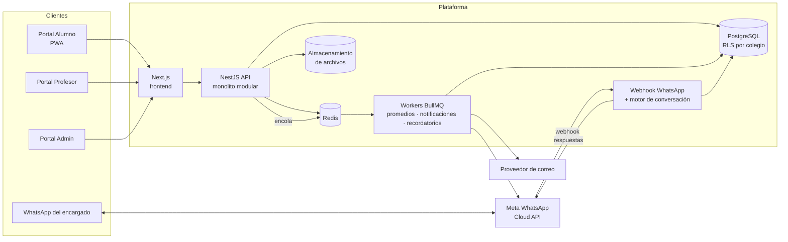

# 05 · Arquitectura técnica

## 1. Principios

1. **Un solo producto, muchos colegios** (SaaS multi-tenant). Nada de forks por cliente: todo lo que varía es configuración.
2. **Modular**: Académico, Comunicación, WhatsApp, Asistencia, Pagos se activan por colegio.
2. **Interfaz personalizable por colegio** mediante temas (tokens de diseño, variantes de componentes, widgets configurables y extensiones a la medida) sin duplicar código. Ver [Diseño UI/UX](14-diseno-ui-ux.md).
3. **Mobile-first**: la mayoría de alumnos y padres usan celular.
4. **TypeScript de punta a punta** para un equipo pequeño: mismo lenguaje en frontend y backend, tipos compartidos.
5. **Empezar como monolito modular**, no microservicios. Separar servicios solo cuando la carga lo justifique (el worker de WhatsApp es el primer candidato).

## 2. Stack recomendado

| Capa | Tecnología | Por qué |
|---|---|---|
| Frontend web | **Next.js** (React, TypeScript), Tailwind CSS, shadcn/ui, TanStack Query | Ecosistema grande, SSR para rendimiento en celulares, fácil de convertir en PWA. |
| Backend API | **NestJS** (TypeScript) | Estructura modular (módulos = dominios), inyección de dependencias, guards para RBAC, buena documentación OpenAPI. |
| ORM | **Prisma** (o Drizzle) | Migraciones versionadas y tipos generados. |
| Base de datos | **PostgreSQL 16+** | Relacional (los datos académicos son muy relacionales), Row-Level Security para multi-tenant, JSONB para configuraciones. |
| Colas y caché | **Redis + BullMQ** | Recálculo de promedios, envíos de WhatsApp/correo, recordatorios programados. |
| Archivos | **Almacenamiento compatible con S3** (AWS S3, Cloudflare R2, MinIO en local) | Entregas de alumnos y material; URLs firmadas temporales. |
| WhatsApp | **WhatsApp Business Platform – Cloud API (Meta)** | Oficial, sin riesgo de bloqueo del número; alternativa vía BSP (Twilio, 360dialog) si se prefiere. |
| Correo | Proveedor transaccional (Amazon SES, Resend, Postmark) | Solo para personal (administradores y profesores) que tenga correo: invitaciones y avisos. Los alumnos no usan correo. |
| Autenticación | Propia con JWT (access + refresh) o Auth.js; usuario + contraseña/PIN (2FA fuera del alcance actual) | Control total del multi-tenant y roles. |
| Búsqueda (futuro) | PostgreSQL full-text → Meilisearch si crece | |
| Observabilidad | Sentry (errores), OpenTelemetry + Grafana/Loki (logs y métricas) | |
| Infraestructura | Docker; despliegue inicial en un PaaS (Railway, Render, Fly.io) o VPS; luego AWS/GCP | Costos bajos al inicio. |
| CI/CD | GitHub Actions | Lint, pruebas, build y despliegue. |

> Alternativa válida si el equipo domina otro stack: Laravel + Inertia/Vue + PostgreSQL. Lo importante es respetar el modelo multi-tenant y la modularidad, no el framework.

## 3. Vista de componentes



## 4. Módulos del backend (dominios)

```
apps/api/src/modules/
├── auth/            # login, refresh, credenciales temporales, restablecimiento
├── tenancy/         # colegios, planes, módulos activos, resolución de tenant
├── users/           # usuarios, roles, perfiles (alumno, profesor, encargado)
├── academic/        # ciclos, periodos, niveles, grados, secciones, materias, clases, asignaciones
├── schedule/        # bloques de horario, calendario escolar
├── coursework/      # actividades, entregas, material
├── grading/         # escalas, categorías, calificaciones, promedios, cierres, boletas
├── observations/    # observaciones de alumnos
├── communication/   # anuncios, foros, notificaciones
├── whatsapp/        # webhook, motor de conversación, plantillas
├── files/           # subida, URLs firmadas, antivirus
├── reports/         # reportes y exportaciones
├── audit/           # bitácora
├── attendance/      # (F2)
└── billing/         # (F3)
```

## 5. Multi-tenancy

**Estrategia:** base de datos compartida, esquema compartido, columna `colegio_id` en todas las tablas de negocio + **PostgreSQL Row-Level Security (RLS)**.

```sql
ALTER TABLE actividad ENABLE ROW LEVEL SECURITY;
CREATE POLICY aislamiento_colegio ON actividad
  USING (colegio_id = current_setting('app.colegio_id')::uuid);
```

- Al inicio de cada petición la API resuelve el colegio (por subdominio o por el token) y ejecuta `SET LOCAL app.colegio_id = '...'` dentro de la transacción.
- Así, aunque un desarrollador olvide un `WHERE colegio_id = ...`, la base de datos no devuelve datos de otro colegio.
- Archivos en S3 con prefijo `colegio_id/`.
- Colegios grandes que lo exijan (plan Enterprise) podrían tener base de datos dedicada en el futuro; el código no cambia.

**Resolución del tenant:** `colegio-san-jose.rexaedu.com` → `colegio.slug = 'colegio-san-jose'`. Opcional: dominio propio del colegio (`portal.colegiosanjose.edu.gt`).

## 6. Autenticación y sesión

- Login con **usuario + contraseña**. El usuario del alumno es su **código/carné** (no requiere correo); los alumnos de primaria pueden usar un **PIN numérico** generado por el colegio.
- El colegio entrega **tarjetas de acceso impresas** por sección con usuario y contraseña temporal; en el primer ingreso se obliga a cambiarla (opcional para primaria baja).
- Si un alumno olvida su contraseña, la restablece el administrador o su profesor titular (no hay recuperación por correo para alumnos).
- **2FA queda fuera del alcance actual.**
- (Plus) "Iniciar sesión con Google / Microsoft" para colegios con Google Workspace for Education o Microsoft 365.
- Access token de corta duración (15 min) + refresh token rotativo en cookie `httpOnly`.
- El token incluye `usuario_id`, `colegio_id` y los roles; el **alcance** (qué clases) se valida en el servidor en cada petición.

## 7. Notificaciones

Un servicio único `NotificationService.notify(evento, destinatarios)` decide los canales según las preferencias:

| Canal | Uso |
|---|---|
| En la aplicación (campana) | Todo |
| Correo | Solo personal con correo: invitaciones y avisos importantes |
| Push web (PWA) | Nueva tarea, tarea calificada, recordatorio |
| WhatsApp | Encargados: anuncios, alertas, observaciones (con plantilla) |

## 8. Entornos

| Entorno | Uso |
|---|---|
| `local` | Docker Compose: Postgres, Redis, MinIO, Mailpit |
| `staging` | Pruebas internas y demos a colegios, con datos ficticios |
| `production` | Clientes |

## 9. Decisiones de arquitectura (ADR)

Las decisiones importantes se registran en `docs/adr/NNNN-titulo.md` (contexto, decisión, consecuencias). Primeras ADR a escribir:

1. ADR-0001 Monolito modular en NestJS.
2. ADR-0002 Multi-tenant con RLS en PostgreSQL.
3. ADR-0003 WhatsApp Cloud API oficial en lugar de librerías no oficiales.
4. ADR-0004 Promedios precalculados en tabla de resumen.
