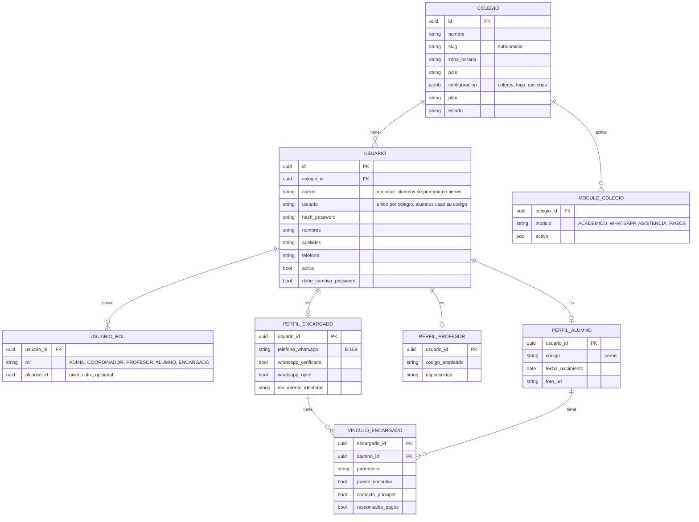
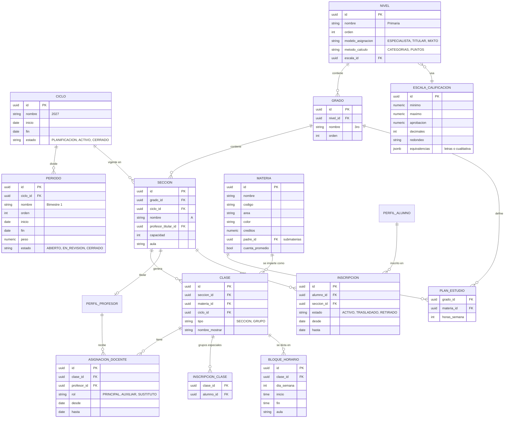
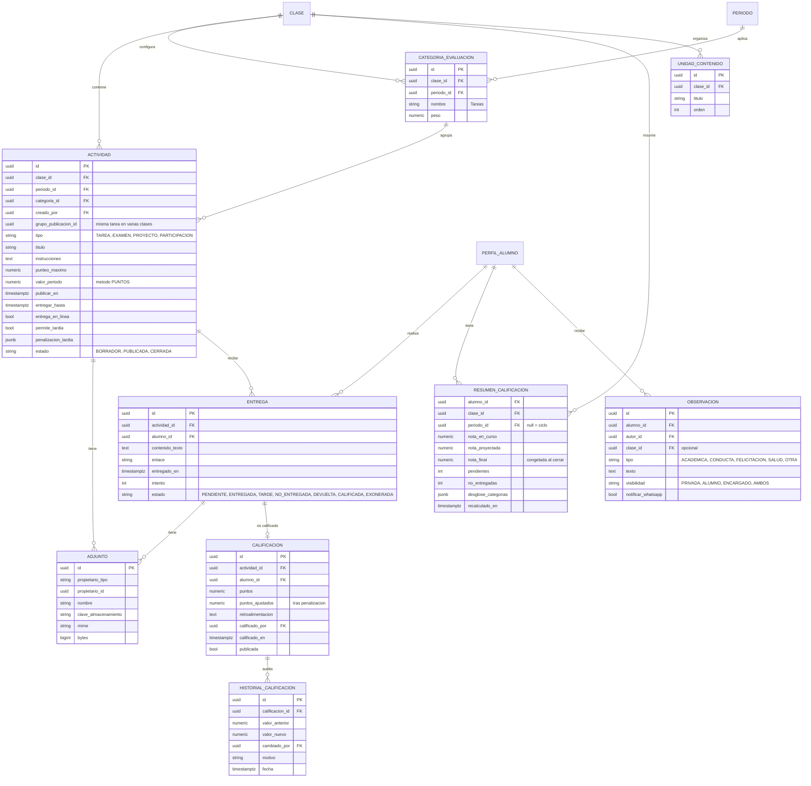
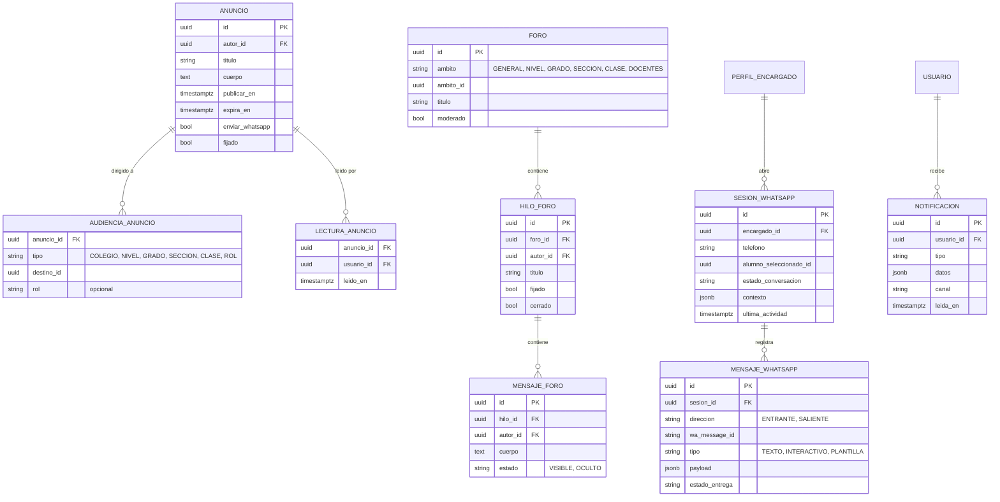

# 06 · Modelo de datos

> Convenciones: todas las tablas de negocio tienen `id uuid`, `colegio_id uuid` (tenant, con RLS), `creado_en`, `actualizado_en`, y borrado lógico `eliminado_en` cuando aplica. En el diagrama se omiten por brevedad. Los nombres de tabla en código irán en inglés o español según se decida en la ADR de convenciones; aquí se usan en español para la comprensión del negocio.

## 1. Diagrama entidad–relación (núcleo)

### 1.1 Colegio, usuarios y roles

### 1.2 Estructura académica

### 1.3 Trabajo académico y calificaciones

### 1.4 Comunicación y WhatsApp

> El detalle del módulo de contenido (unidades, recursos y apartados generales con audiencia) está en [15 · Módulo de contenido](15-modulo-contenido.md).

## 2. Tablas para fases futuras (reservadas)

**Asistencia (F2):** `sesion_asistencia (clase_id | seccion_id, fecha, tomada_por)`, `registro_asistencia (sesion_id, alumno_id, estado, minutos_tarde, nota)`, `justificacion (alumno_id, desde, hasta, motivo, adjunto, aprobada_por)`.

**Pagos (F3):** `concepto_cobro`, `plan_cobro (nivel/grado, montos, fechas)`, `cargo (alumno_id, concepto, monto, vence_en, estado)`, `descuento_beca`, `pago (familia/encargado, monto, metodo, referencia_pasarela)`, `aplicacion_pago (pago_id, cargo_id, monto)`, `recibo`.

## 3. Índices clave

- `actividad (colegio_id, clase_id, entregar_hasta)` — tareas próximas.
- `entrega (actividad_id, alumno_id)` único por intento.
- `calificacion (actividad_id, alumno_id)` único.
- `resumen_calificacion (alumno_id, periodo_id)` — consultas de alumno y WhatsApp.
- `perfil_encargado (telefono_whatsapp)` único por colegio — identificación en el bot.
- `asignacion_docente (profesor_id, clase_id)`.
