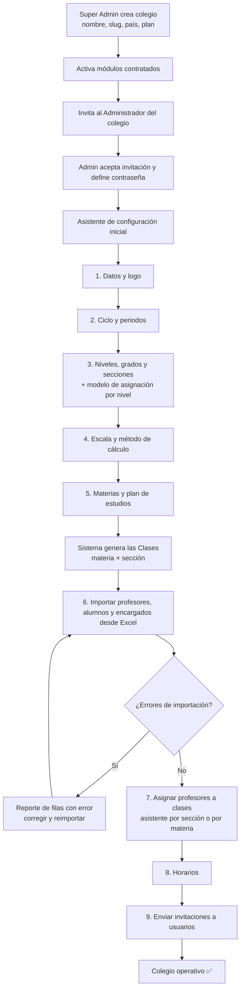
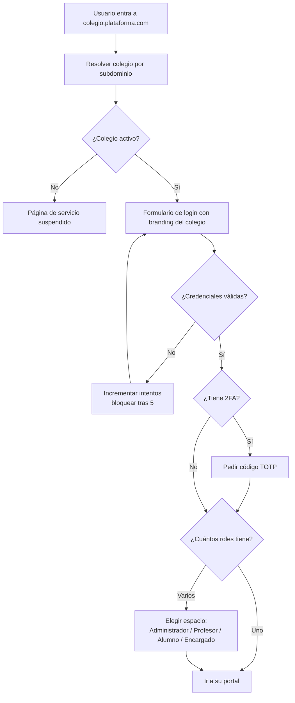
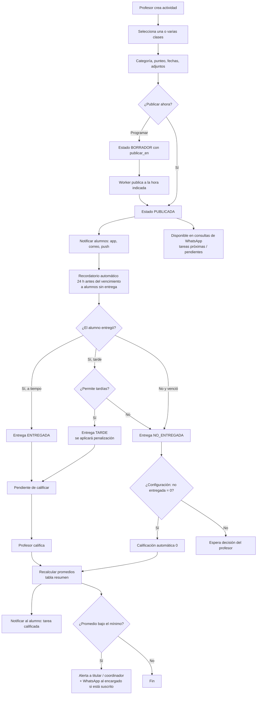
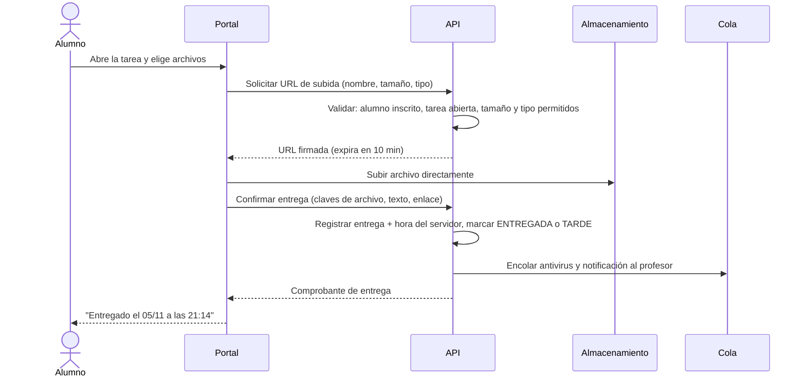
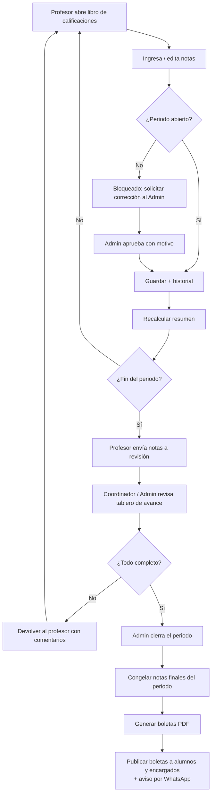
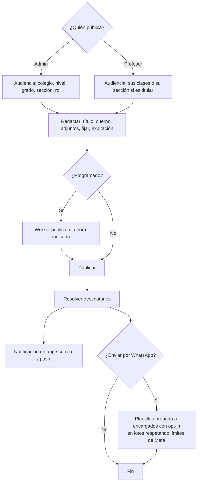
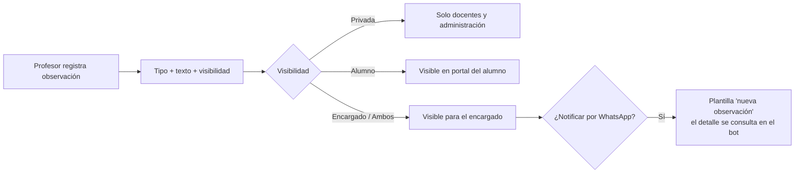
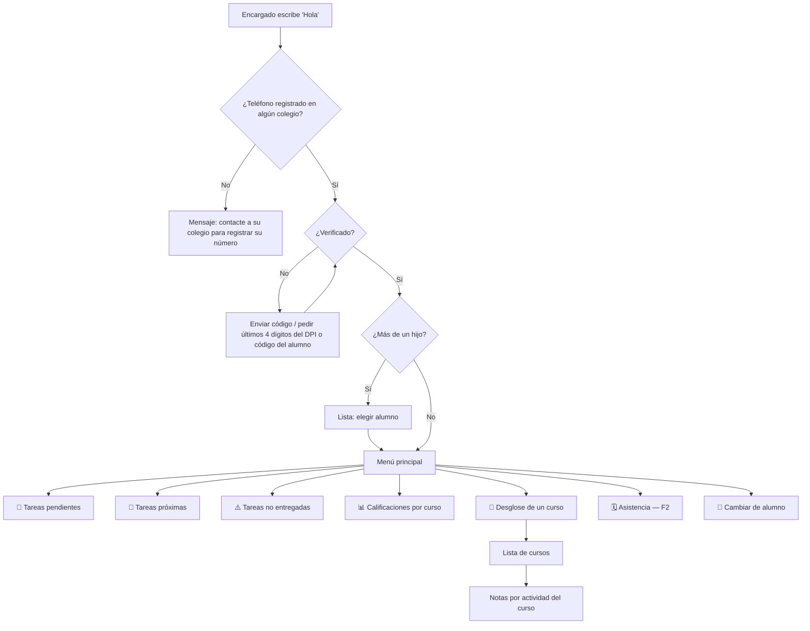
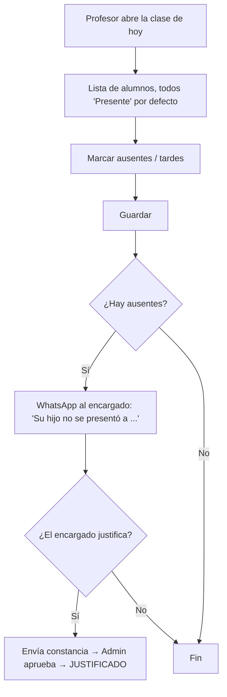
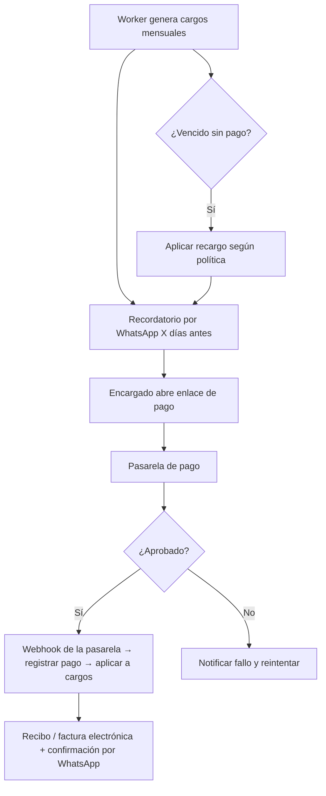

# 07 · Diagramas de flujo

Los diagramas usan [Mermaid](https://mermaid.js.org/) y GitHub los muestra directamente.

## 1. Alta de un colegio nuevo (onboarding)

## 2. Inicio de sesión y selección de espacio

## 3. Ciclo de vida de una tarea

## 4. Entrega de tarea por el alumno

## 5. Calificación y cierre de periodo

## 6. Publicación de anuncios

## 7. Observaciones de alumno

## 8. Consulta del encargado por WhatsApp (resumen)

El detalle completo está en [Integración WhatsApp](08-integracion-whatsapp.md).

## 9. Asistencia (Fase 2 — diseño previo)

## 10. Pago de colegiatura (Fase 3 — diseño previo)

