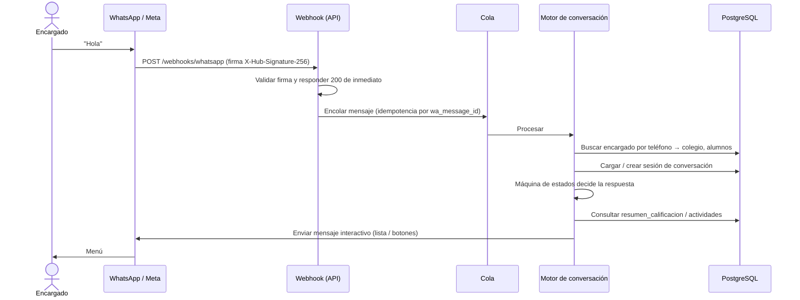
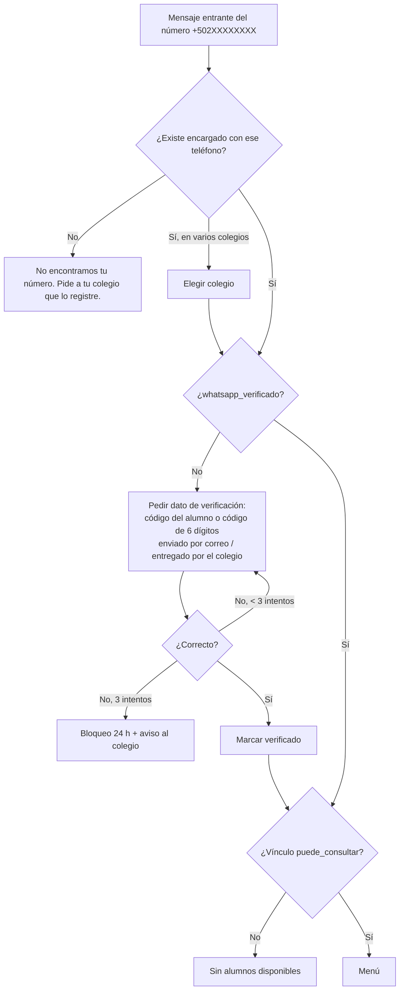

# 08 · Integración con WhatsApp para encargados

Es el **diferenciador principal** del producto: el padre no instala nada ni recuerda contraseñas; consulta desde el WhatsApp que ya usa.

## 1. Proveedor

**WhatsApp Business Platform – Cloud API de Meta** (oficial).

| Opción | Pros | Contras |
|---|---|---|
| **Cloud API directa (Meta)** ✅ recomendada | Sin intermediarios, menor costo, documentación oficial | Hay que gestionar la verificación del negocio y las plantillas |
| BSP (Twilio, 360dialog, Gupshup...) | Panel y soporte adicionales, onboarding más guiado | Cobro adicional por mensaje o mensualidad |
| Librerías no oficiales (WhatsApp Web) | Gratis | ❌ **Violan los términos**, el número puede ser bloqueado, no son aptas para un producto comercial |

### Estrategia de números

- **Opción A — Número de la plataforma (recomendada para iniciar):** un solo número del producto atiende a todos los colegios. El bot identifica el colegio por el teléfono del encargado. Más simple y barato.
- **Opción B — Número propio por colegio (plan premium):** cada colegio registra su número bajo la cuenta de la plataforma (Embedded Signup, como "Tech Provider"). Se ve el nombre y logo del colegio en WhatsApp. El código lo soporta desde el inicio guardando `colegio.whatsapp_phone_number_id`.

Si un mismo número de teléfono es encargado en **dos colegios** (opción A), el bot pregunta primero de qué colegio desea consultar.

## 2. Reglas de WhatsApp que condicionan el diseño

1. **Ventana de servicio de 24 h:** cuando el encargado escribe, durante 24 h el bot puede responder con mensajes libres (texto, listas, botones). Las respuestas a consultas caen aquí.
2. **Mensajes iniciados por el negocio** (anuncios, alertas, boletas, recordatorios) fuera de esa ventana solo con **plantillas aprobadas** por Meta, categorizadas como *Utility* o *Marketing*. Tienen costo por mensaje según país y categoría — **verificar la tarifa vigente de Meta** al momento de cotizar.
3. **Opt-in:** se debe contar con el consentimiento del encargado para recibir mensajes. Se captura en la inscripción (formulario del colegio) y se registra con fecha.
4. **Mensajes interactivos:** listas (hasta 10 opciones por lista) y botones de respuesta (hasta 3). Ideal para menús.
5. **Límites de envío** por número según su nivel de calidad; los envíos masivos se hacen en lotes con cola.

## 3. Arquitectura del bot



- El webhook **siempre responde 200 rápido** y procesa en segundo plano (Meta reintenta si tarda).
- **Idempotencia**: Meta puede reenviar el mismo evento; se descarta si `wa_message_id` ya existe.
- **Máquina de estados** por sesión (`INICIO → VERIFICACION → SELECCION_ALUMNO → MENU → DETALLE_CURSO ...`). Sesión expira tras 30 min de inactividad (vuelve al menú).
- Las consultas leen de la tabla `resumen_calificacion` precalculada, para responder en < 1 s.

## 4. Identificación y seguridad



- El número de teléfono por sí solo **no basta** la primera vez (los números se reciclan); se exige verificación inicial.
- Si administración cambia el teléfono de un encargado, se reinicia la verificación.
- Nunca se envían datos de alumnos no vinculados; cada consulta valida el vínculo.
- Todo mensaje se registra (`mensaje_whatsapp`) para auditoría y soporte; se aplica política de retención (p. ej. 12 meses).

## 5. Diseño de la conversación

### Bienvenida y menú (mensaje de lista)

```
👋 Hola, María. Estás consultando a *Ana López* (3.º Primaria A)
Colegio San José

[ Ver opciones ▾ ]
 ├─ 📌 Tareas pendientes
 ├─ 📅 Tareas próximas (7 días)
 ├─ ⚠️ Tareas no entregadas
 ├─ 📊 Calificaciones por curso
 ├─ 🔎 Detalle de un curso
 ├─ 📢 Últimos anuncios
 ├─ 🗓 Asistencia            (Fase 2)
 └─ 🔄 Cambiar de alumno
```

### Tareas pendientes

```
📌 *Tareas pendientes de Ana* (aún en plazo)

1. Matemática — Ejercicios pág. 45
   Entrega: jue 07/11, 23:59
2. Ciencias — Maqueta del sistema solar
   Entrega: lun 11/11, 07:00
3. Inglés — Vocabulary list
   Entrega: mar 12/11, 23:59

✅ Ya entregadas esta semana: 4
[Menú]  [Tareas no entregadas]
```

### Tareas no entregadas

```
⚠️ *Tareas no entregadas* (vencidas)

• Lenguaje — Resumen del cuento (venció 01/11) · 0/10
• Estudios Sociales — Mapa de América (venció 30/10) · 0/15

Puedes comunicarte con el profesor desde el portal del colegio.
[Menú]
```

### Calificaciones por curso

```
📊 *Calificaciones — Bimestre 3* (en curso)
Nota mínima: 60

🟢 Matemática ........ 85.0
🟢 Ciencias .......... 78.5
🟡 Lenguaje .......... 64.0
🔴 Estudios Sociales . 52.3  (2 no entregadas)
🟢 Inglés ............ 91.0

📈 Promedio general: 74.2
[Detalle de un curso]  [Menú]
```

### Detalle de un curso (desglose por actividad)

```
🔎 *Estudios Sociales — Bimestre 3*
Profesor: Carlos Méndez

Tareas (30%) ........ 40%
 • Línea de tiempo ........ 8/10
 • Mapa de América ........ 0/15 ❌ no entregada
Exámenes (50%) ...... 62%
 • Parcial 1 .............. 62/100
Proyecto (20%) ...... pendiente de calificar

Nota actual: *52.3* 🔴
[Otro curso]  [Menú]
```

### Comandos de texto

Además de los menús, el bot entiende palabras clave: `menu`, `tareas`, `notas`, `pendientes`, `cambiar`, `ayuda`, `salir`. En la fase Plus, consultas en lenguaje natural con un modelo de lenguaje restringido a las herramientas de consulta del sistema (sin acceso libre a la base de datos).

## 6. Mensajes salientes (plantillas a registrar en Meta)

| Plantilla | Categoría | Disparador | Ejemplo |
|---|---|---|---|
| `verificacion_codigo` | Authentication | Primer uso | "Tu código de verificación es {{1}}." |
| `anuncio_colegio` | Utility | Anuncio con envío por WhatsApp | "📢 {{1}}: {{2}}. Más información en el portal." |
| `observacion_nueva` | Utility | Observación con notificación | "Hay una nueva observación de {{1}} sobre {{2}}. Escribe *menú* para consultarla." |
| `tareas_no_entregadas` | Utility | Diario / semanal si hay vencidas | "{{1}} tiene {{2}} tarea(s) sin entregar. Escribe *no entregadas* para ver detalle." |
| `alerta_rendimiento` | Utility | Promedio bajo el mínimo | "El promedio de {{1}} en {{2}} es {{3}}, por debajo de {{4}}." |
| `resumen_semanal` | Utility | Domingo por la tarde (suscripción) | Resumen de la semana |
| `boleta_disponible` | Utility | Cierre de periodo | "La boleta del {{1}} de {{2}} ya está disponible." |
| `ausencia_alumno` | Utility | F2 | "{{1}} fue marcado ausente hoy en {{2}}." |
| `recordatorio_pago` | Utility | F3 | "Recordatorio: la colegiatura de {{1}} vence el {{2}}. Pagar: {{3}}" |

> Buena práctica: la plantilla **avisa** y el detalle se entrega cuando el padre responde (ya dentro de la ventana de 24 h), lo que reduce costos y evita exponer datos sensibles en notificaciones.

## 7. Configuración por colegio

- Activar/desactivar el módulo WhatsApp.
- Qué consultas están habilitadas (p. ej. ocultar calificaciones hasta que el profesor las publique).
- Horario de envío de notificaciones (no enviar de 21:00 a 7:00).
- Límite mensual de mensajes salientes incluidos en el plan; excedentes facturables.
- Mensaje de bienvenida personalizado.

## 8. Costos a considerar en el precio de venta

- Conversaciones/mensajes con plantilla (pagados a Meta, varían por país).
- Las respuestas dentro de la ventana de servicio iniciada por el usuario son gratuitas o de bajo costo según la política vigente de Meta (verificar).
- Se recomienda incluir un paquete de mensajes en cada plan y medir el uso por colegio (`RF-PLT-04`).

## 9. Pruebas

- Número de prueba de Meta para desarrollo.
- Simulador local: endpoint `/dev/whatsapp/simular` que inyecta mensajes al motor sin pasar por Meta, para pruebas automáticas de la máquina de estados.
