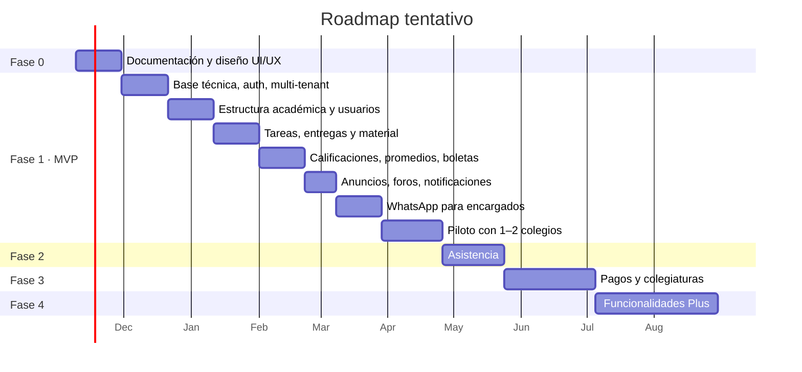

# 12 · Roadmap

Las duraciones son estimadas para un equipo de 2–3 desarrolladores y se deben ajustar al iniciar.

## Fase 0 — Documentación y diseño *(actual)*
- [x] Visión, alcance, roles, requerimientos.
- [x] Modelo académico flexible, modelo de datos, flujos, arquitectura.
- [x] Lineamientos de diseño UI/UX y personalización por colegio ([14](14-diseno-ui-ux.md)).
- [x] Entorno de desarrollo del frontend: monorepo pnpm + Turborepo, Next.js, Tailwind, ESLint, Prettier, Vitest y CI en GitHub Actions.
- [x] Sistema de diseño base (tokens + componentes) y 3 temas de muestra, con validación automática de contraste.
- [x] Logo y tema del colegio de demostración REXAEDU.
- [x] Prototipo del portal del alumno: inicio de sesión, inicio (primaria y secundaria), tareas, detalle y entrega, calificaciones por materia y horario.
- [x] Prototipo del portal del profesor: inicio, mis clases (se adapta a especialista o titular), crear tarea en varias clases, calificar entregas con penalización por atraso, libro de calificaciones editable con exportación a Excel y resumen de sección del titular.
- [x] Módulo de contenido: material por clase administrado por el profesor y apartados generales por audiencia ([15](15-modulo-contenido.md)).
- [x] Prototipo de administración: tablero, estructura académica, asignación docente con detección de clases sin profesor y sobrecarga, usuarios, importación CSV con validación, tarjetas de acceso, anuncios (con vista previa de WhatsApp), foros con moderación y configuración inicial.
- [ ] Validar con 2–3 colegios reales (entrevistas a dirección, profesores y padres).
- [ ] Escribir ADR-0001 a ADR-0004.
- [ ] Crear cuenta de Meta Business y número de prueba de WhatsApp.

## Fase 1 — MVP
**Sprint 1–2 · Base técnica**
- Monorepo (pnpm + Turborepo), Docker Compose local, CI en GitHub Actions.
- NestJS + Prisma + PostgreSQL con RLS; Next.js con layout por rol.
- Autenticación, resolución de colegio por subdominio, RBAC.
- Super Admin: alta de colegio y administrador.

**Sprint 3–4 · Estructura académica**
- Ciclos, periodos, niveles (modelo de asignación), grados, secciones, materias, plan de estudios, generación de clases.
- Usuarios + importación Excel; vínculos encargado-alumno.
- Asignación docente (asistentes por sección y por materia); horarios.

**Sprint 5–6 · Trabajo académico**
- Actividades (multi-clase), material, entregas con archivos, estados.
- Portal alumno: dashboard, calendario, entrega.

**Sprint 7–8 · Calificaciones**
- Escalas, categorías, métodos A y B, libro de calificaciones, recálculo en cola, tabla resumen.
- Promedios en portal alumno; cierre de periodo; boletas PDF; bitácora.

**Sprint 9 · Comunicación**
- Anuncios segmentados, foros, observaciones, notificaciones (app y push; correo solo para personal).

**Sprint 10–11 · WhatsApp**
- Webhook, verificación, máquina de estados, menús y consultas (pendientes, próximas, no entregadas, notas, desglose).
- Plantillas: anuncio, observación, boleta.

**Piloto**
- Implementar en 1–2 colegios, capacitación, recoger retroalimentación, corregir.

**Criterio de salida del MVP:** un colegio opera un periodo completo (publicar tareas → calificar → cerrar → boleta) y ≥ 50 % de encargados consultan por WhatsApp.

## Fase 2 — Asistencia
Diaria o por clase, justificaciones, alerta por WhatsApp, reportes, consulta en el bot.

## Fase 3 — Pagos
Conceptos, cargos automáticos, becas/descuentos, pasarela local, recibos, recordatorios y pago por WhatsApp, facturación electrónica por país.

## Fase 4 — Plus
Priorizar con datos del piloto. Candidatos: alertas tempranas y resumen semanal, IA en WhatsApp, rúbricas, exámenes en línea, tablero de dirección, autorizaciones digitales, integración Google/Microsoft, app nativa.

## Backlog inicial sugerido (épicas para GitHub Issues)

| Épica | Requerimientos |
|---|---|
| E01 Infraestructura y CI | RNF-01..11 |
| E02 Autenticación y multi-tenant | RF-PLT-01..03, RNF-05 |
| E03 Configuración del colegio | RF-ADM-01..06 |
| E04 Estructura académica | RF-ADM-10..15 |
| E05 Usuarios e importación | RF-ADM-20..26 |
| E06 Actividades y entregas | RF-PRO-03..05, RF-ALU-04 |
| E07 Calificaciones y promedios | RF-PRO-06..09, RF-ALU-05..06, RF-ADM-40..44 |
| E08 Portal alumno | RF-ALU-01..12 |
| E09 Portal profesor | RF-PRO-01..02, 10..14 |
| E10 Comunicación | RF-ADM-30..33, RF-PRO-11..12 |
| E11 WhatsApp | RF-WA-01..09 |
