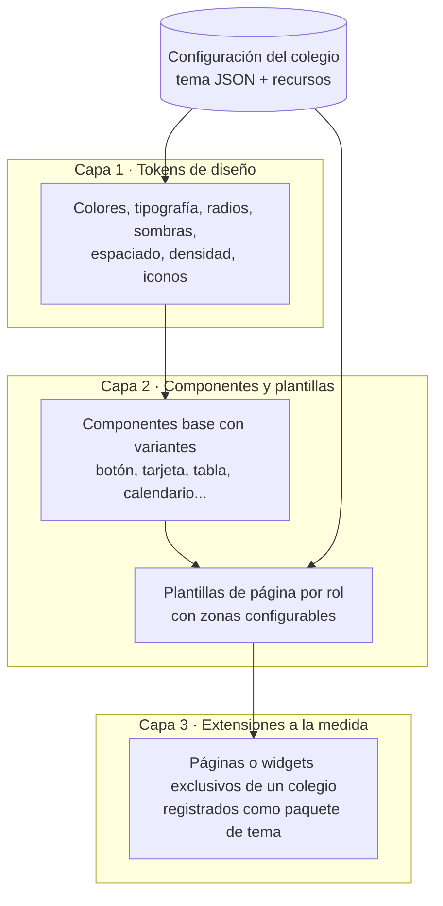
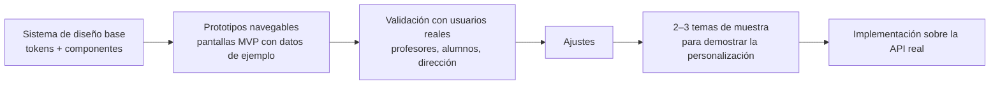

# 14 · Diseño UI/UX y personalización por colegio

## 1. Enfoque: mismo núcleo, experiencia a la medida

RexaEdu **no entrega la misma interfaz a todos los colegios**. Cada colegio recibe un diseño adaptado a su identidad (colores, tipografía, logo, estilo, página de inicio, tono), pero **todas las funcionalidades vienen del mismo núcleo** descrito en esta documentación.

| Se comparte entre todos los colegios | Se personaliza por colegio |
|---|---|
| Reglas de negocio, API, base de datos, permisos | Paleta de colores, tipografías, logo, favicon, imágenes |
| Funcionalidades (tareas, notas, WhatsApp...) | Estilo de componentes: bordes, sombras, densidad, iconografía |
| Accesibilidad, rendimiento, seguridad | Página pública de inicio / login del colegio |
| Componentes base probados | Disposición del panel de inicio (qué tarjetas aparecen y en qué orden) |
| | Textos y tono (formal / cercano), nombres de periodos y niveles |
| | Formato de boletas y documentos PDF |
| | Pantallas o secciones a la medida (cuando el contrato lo incluya) |

> **Regla de oro:** la personalización se hace por **configuración y temas**, nunca copiando el código del producto para un colegio. Así una corrección o mejora del núcleo llega a todos los colegios a la vez.

## 2. Arquitectura de personalización (3 capas)

1. **Tokens de diseño** — variables CSS cargadas según el colegio (`--color-primario`, `--fuente-titulos`, `--radio-base`...). Cambiar un colegio de "institucional azul marino" a "moderno y colorido" es solo cambiar el tema.
2. **Componentes y plantillas** — cada componente tiene variantes (p. ej. tarjeta `plana`, `elevada`, `con borde`) y cada página de inicio tiene **zonas** donde se eligen qué widgets aparecen (próximas tareas, promedio, anuncios, horario, frase del día...).
3. **Extensiones a la medida** — para requerimientos especiales de un colegio se crea un paquete `themes/<colegio>` con páginas o widgets propios que usan la misma API. Se activan solo para ese colegio.

El tema de cada colegio se guarda como JSON en `colegio.configuracion.tema` y se puede editar desde un **editor visual de marca** en el portal de Super Admin (vista previa en vivo).

## 3. Principios de diseño

1. **Claro antes que bonito, pero bonito.** Cada pantalla responde a una pregunta: "¿qué tengo que entregar?", "¿cómo voy?", "¿qué me falta calificar?".
2. **Mobile-first.** Se diseña primero para un celular de 360 px de ancho; luego tableta y escritorio.
3. **Una acción principal por pantalla**, visible y grande.
4. **Estados con color + ícono + texto** (nunca solo color): 🟢 aprobado, 🟡 en riesgo, 🔴 reprobado; pendiente, entregado, tarde, no entregado.
5. **Descriptivo:** etiquetas completas, ayudas contextuales, estados vacíos que explican qué hacer ("Aún no hay tareas. Cuando tu profesor publique una, aparecerá aquí").
6. **Adecuado a la edad:** el portal de alumno tiene dos modos visuales:
   - **Primaria:** íconos grandes, ilustraciones, colores por materia, poco texto, navegación de un nivel.
   - **Secundaria:** más información por pantalla, gráficas de promedio, calendario completo.
7. **Rápido de operar para el profesor:** libro de calificaciones tipo hoja de cálculo, atajos de teclado, guardado automático.
8. **Accesible:** contraste WCAG AA, tamaños táctiles ≥ 44 px, navegación con teclado, modo oscuro.

## 4. Usuarios objetivo (personas)

| Persona | Contexto | Lo que necesita ver primero |
|---|---|---|
| **Sofía, 8 años, 3.º primaria** | Usa la tableta o el celular de su mamá | Sus tareas de hoy con dibujos/colores de cada materia |
| **Diego, 15 años, 4.º bachillerato** | Celular propio, todo el día conectado | Qué vence esta semana y su promedio por materia |
| **Profa. Ana, titular de 2.º B** | Imparte todas las materias de su sección; laptop en clase | Su sección completa: qué calificar y quién va mal |
| **Prof. Luis, Matemática en 6 secciones** | Muchos alumnos, poco tiempo | Publicar una tarea en varias secciones y calificar rápido |
| **Lic. Marta, coordinadora** | Escritorio, revisa avance | Tablero: profesores atrasados, alumnos en riesgo |
| **Don Carlos, papá** | Solo usa WhatsApp | Mensajes cortos y claros (ver [WhatsApp](08-integracion-whatsapp.md)) |

## 5. Mapa de pantallas a diseñar (prioridad para el MVP)

### Comunes
- Login con marca del colegio (usuario/código + contraseña o PIN) · Cambio de contraseña temporal · Selector de espacio (si tiene varios roles).

### Alumno
1. **Inicio** — tareas para hoy / esta semana, vencidas, promedio general, anuncios, clases de hoy.
2. **Calendario / agenda** — semana con bloques de horario y tareas.
3. **Detalle de tarea + entrega** — instrucciones, adjuntos, subir archivos, comprobante.
4. **Mis calificaciones** — promedio por clase, desglose por categoría y actividad, gráfica de evolución.
5. **Clase** — material, actividades, anuncios, foro.

### Profesor
1. **Inicio** — agenda del día, "por calificar", clases (agrupadas por sección o por materia según su carga).
2. **Crear tarea** — formulario en pasos, publicar en varias clases.
3. **Calificar entregas** — visor de archivo + punteo + retroalimentación, pasar al siguiente alumno.
4. **Libro de calificaciones** — hoja alumnos × actividades, promedios en vivo.
5. **Observaciones y anuncios.**

### Administrador
1. **Tablero** — indicadores del colegio.
2. **Asistente de configuración inicial.**
3. **Estructura académica** — niveles, grados, secciones, materias.
4. **Asignación docente** — cuadrícula por sección o por materia.
5. **Usuarios + importación Excel + tarjetas de acceso imprimibles.**
6. **Anuncios y foros.**

### Super Admin
- Colegios, módulos y **editor visual de marca** (tema).

## 6. Proceso de diseño propuesto

Los prototipos se construyen **directamente en el código del frontend** (Next.js + Tailwind con datos de ejemplo), no solo en una herramienta de diseño, para que el trabajo de diseño no se tire: los mismos componentes pasan a producción cuando se conecte la API.

## 7. Temas de muestra para la venta

Para demostrar que cada colegio tendrá su propia experiencia, se prepararán al menos tres temas de demostración:

| Tema | Estilo | Para |
|---|---|---|
| **Institucional** | Azul marino y dorado, tipografía serif en títulos, sobrio | Colegios tradicionales |
| **Moderno** | Neutros con un color de acento, mucho espacio en blanco, bordes redondeados | Colegios bilingües / tecnológicos |
| **Infantil** | Colores vivos por materia, ilustraciones, íconos grandes | Preprimaria y primaria |
