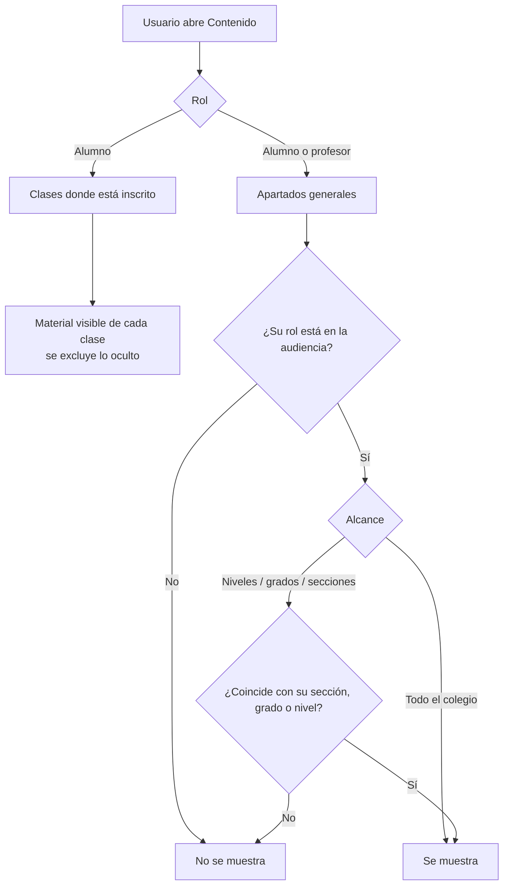
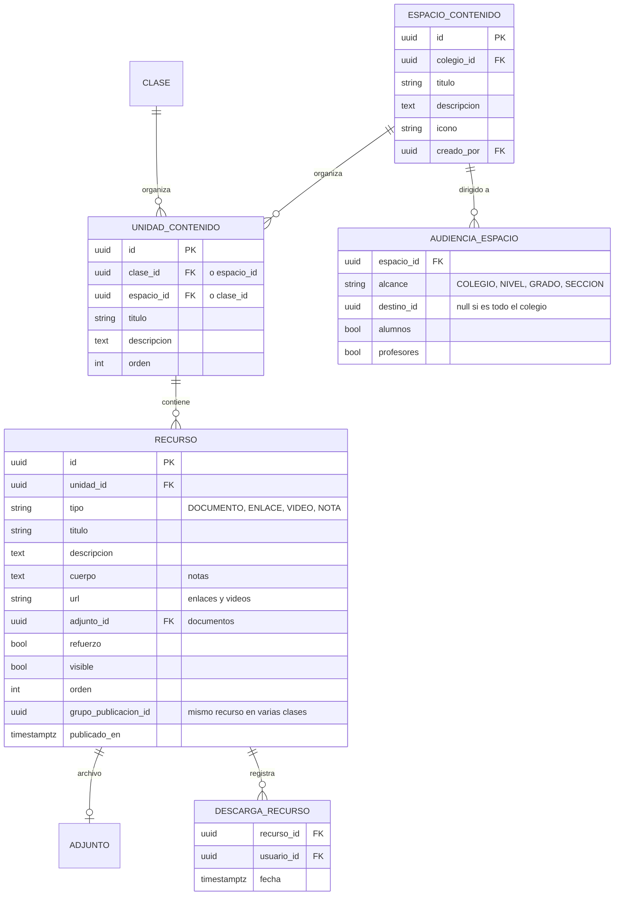

# 15 · Módulo de contenido

Material didáctico y de reforzamiento organizado por clase, más apartados de contenido general del colegio.

## 1. Dos tipos de contenido

| | **Contenido de clase** | **Contenido general** |
|---|---|---|
| Quién lo administra | El profesor asignado a la clase | Administración / coordinación |
| Organización | Unidades (p. ej. «Unidad 3 · Funciones cuadráticas») | Apartados con carpetas (p. ej. «Orientación vocacional») |
| Quién lo ve | Los alumnos inscritos en la clase | La audiencia definida: todo el colegio, niveles, grados o secciones; alumnos, profesores o ambos |
| Qué pueden hacer los alumnos | Ver, abrir y descargar | Ver, abrir y descargar |

Los alumnos **nunca** pueden subir, editar ni borrar contenido. Las entregas de tareas son otro módulo.

## 2. Tipos de material

| Tipo | Uso | Al abrirlo |
|---|---|---|
| **Documento** | PDF, Word, PowerPoint, Excel, imágenes, ZIP (hasta 25 MB) | Se descarga con su nombre original |
| **Enlace** | Páginas de apoyo (GeoGebra, PhET, RAE…) | Se abre en otra pestaña |
| **Video** | YouTube, Khan Academy u otros | Se abre en otra pestaña (fase Plus: reproductor incrustado) |
| **Nota** | Texto breve: resúmenes, instrucciones, trucos | Se lee en la misma página |

Cada material puede marcarse como **reforzamiento** (repaso o práctica extra) y como **oculto** (borrador que solo ve el profesor o la administración).

## 3. Funciones por rol

### Profesor
- Crear, renombrar y eliminar unidades.
- Agregar, editar, ocultar o mostrar, reordenar y eliminar material.
- **Publicar el mismo material en varias clases** de la misma materia (útil para el profesor especialista con varias secciones).
- Consultar los apartados generales dirigidos a profesores (p. ej. «Formación docente»).

### Alumno
- Ver el contenido de cada una de sus clases y de los apartados que le corresponden.
- Buscar y filtrar por tipo (documentos, enlaces, videos, notas, reforzamiento).
- Ver el material **nuevo** (últimos 7 días) en su inicio.
- En primaria, la interfaz usa textos más grandes («Mis materiales»).

### Administración
- Crear apartados con nombre, descripción y audiencia.
- Ver una estimación de cuántos alumnos y profesores lo verán, y un aviso si la audiencia queda vacía.
- Administrar el material del apartado con el mismo editor que usan los profesores.

## 4. Reglas de visibilidad

- Para un profesor, sus secciones son las de las clases que tiene asignadas.
- La validación se hace **en el servidor**: abrir la dirección de un apartado ajeno devuelve «no encontrado».

## 5. Modelo de datos

- Una unidad pertenece a **una clase o a un espacio** (exactamente uno de los dos; restricción `CHECK`).
- `grupo_publicacion_id` enlaza las copias de un recurso publicado en varias clases, para editarlas juntas (fase Plus).
- `DESCARGA_RECURSO` permite al profesor saber quién vio o descargó el material (fase Plus).

## 6. Archivos

- Se guardan en almacenamiento compatible con S3 con prefijo `colegio_id/contenido/…`.
- Subida con URL firmada (como las entregas de tareas, ver [Flujos](07-flujos.md) §4), con antivirus antes de quedar disponible.
- La descarga usa una URL firmada de corta duración que se genera solo si el usuario tiene acceso al recurso.
- Límite por archivo configurable por colegio (25 MB por defecto) y cuota total por plan.

## 7. Funciones Plus del módulo

- Reproductor de video incrustado y vista previa de PDF sin descargar.
- Estadísticas: quién abrió o descargó cada material.
- Programar la publicación de material (fecha y hora).
- Copiar unidades completas de un ciclo al siguiente.
- Avisar a las familias por WhatsApp cuando se publica material de reforzamiento.
